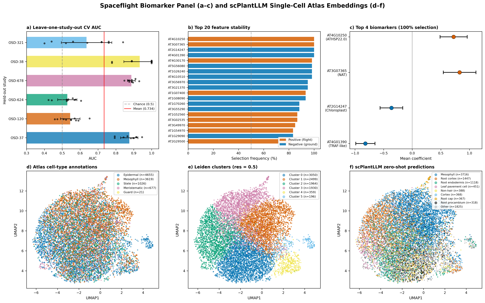
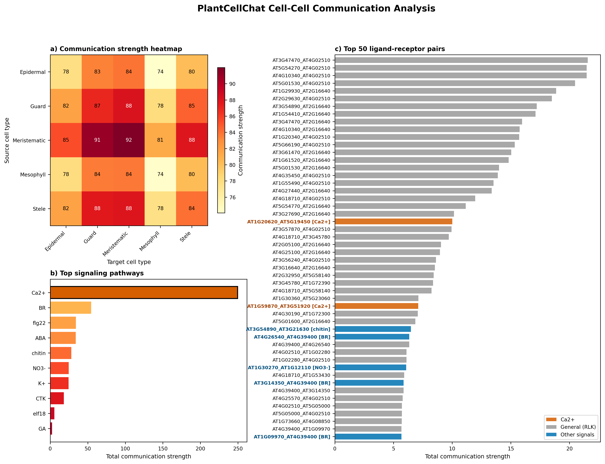
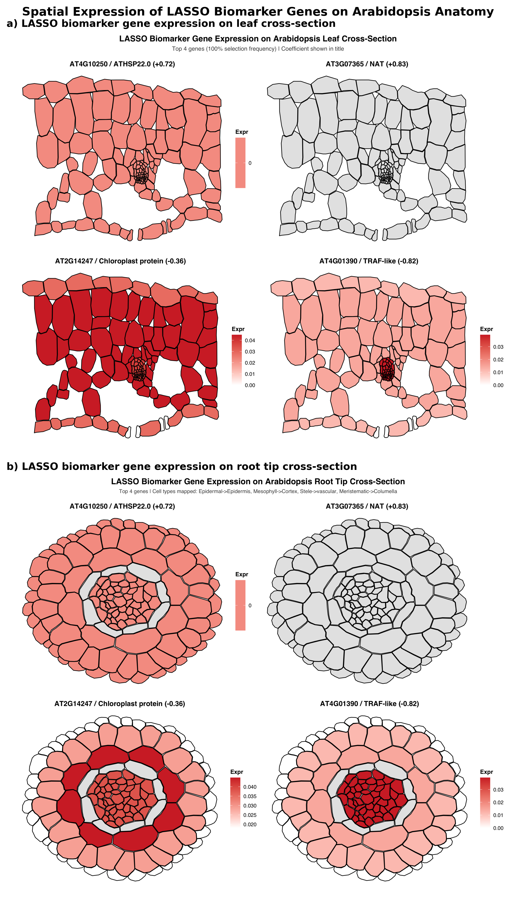
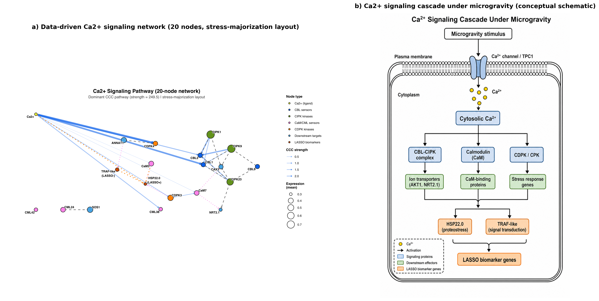
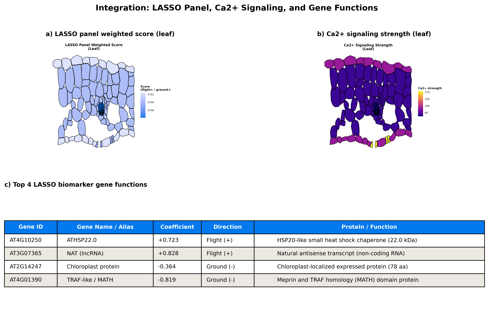
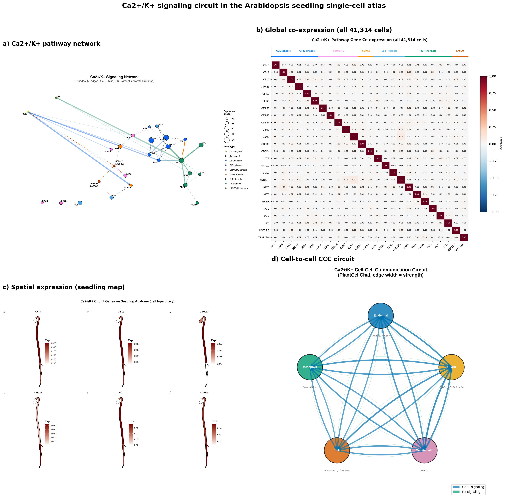
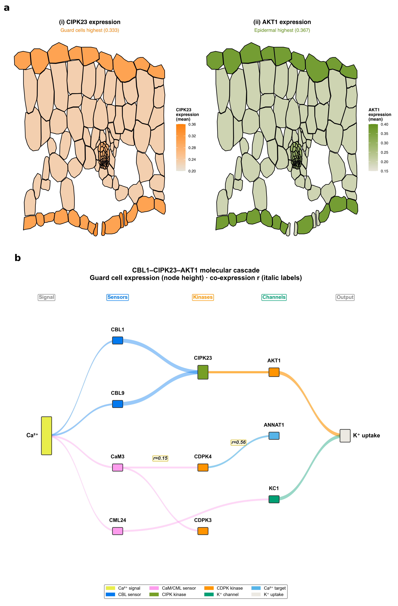

**LASSO biomarker panel and single-cell atlas integration reveal Ca²⁺-dominated cell–cell communication in the *Arabidopsis thaliana* spaceflight response.**

A multi-track computational integration of pooled NASA OSDR bulk transcriptomics, a seed-to-seed single-cell atlas, plant foundation model embeddings, and intercellular signaling inference. Manuscript formatted for submission to *npj Microgravity*.

> **Richard Barker** — GeneLab Plant Analysis Working Group, NASA Open Science Data Repository (`dr.richard.barker@gmail.com`)

  

    
0.734

    <h3>LASSO Mean CV AUC</h3>
    
85 stable biomarkers across 156 samples (6 NASA OSDR studies; 100% selection for 4 genes).

  

  

    
249.5

    <h3>Ca²⁺ CCC Dominance</h3>
    
4.6× higher than brassinosteroid (BR) and 10.2× higher than K⁺; guard cells are the primary Ca²⁺ source.

  

  

    
27 / 56

    <h3>Ca²⁺/K⁺ Circuit</h3>
    
27-node, 56-edge CBL1–CIPK23–AKT1 crosstalk network linking guard-cell CIPK23 to epidermal AKT1.

  

  

    
41,314

    <h3>Single-Cell Atlas</h3>
    
GSE226097 seedling atlas (9,998-cell stratified subsample for scPlantLLM; full atlas for circuit expression).

  

---

## Integrated Manuscript & Submission Reader {#manuscript-reader}

Read the complete illustrated manuscript, the text-only submission manuscript (with Table 1), or the editorial cover letter directly below, or switch to **Canvas Reader** on mobile/touch devices.

  

    

      <button type="button" role="tab" id="tab-illustrated" aria-selected="true" tabindex="0"
        data-pdf="manuscript/manuscript_with_figures.pdf"
        data-docx="manuscript/manuscript_with_figures.docx"
        data-meta="Illustrated manuscript · 7 inline figures + Table 1 · PDF &amp; DOCX">
        Illustrated Manuscript
      </button>
      <button type="button" role="tab" id="tab-submission" aria-selected="false" tabindex="-1"
        data-pdf="manuscript/manuscript.pdf"
        data-docx="manuscript/manuscript.docx"
        data-meta="Submission manuscript · npj Microgravity format + Table 1 + Legends · PDF &amp; DOCX">
        Submission Text (npj)
      </button>
      <button type="button" role="tab" id="tab-cover" aria-selected="false" tabindex="-1"
        data-pdf="manuscript/cover_letter.pdf"
        data-docx="manuscript/cover_letter.docx"
        data-meta="Editorial cover letter · npj Microgravity · PDF &amp; DOCX">
        Cover Letter
      </button>
    

    

      <button type="button" class="btn" data-mode-toggle aria-pressed="false">Canvas Reader (Mobile/Zoom)</button>
      <a class="btn" data-pdf-open href="manuscript/manuscript_with_figures.pdf" target="_blank" rel="noopener">Open Tab</a>
      <a class="btn primary" data-pdf-download href="manuscript/manuscript_with_figures.pdf" download>Download PDF</a>
      <a class="btn" data-docx-download href="manuscript/manuscript_with_figures.docx" download>DOCX</a>
    

  

  

    

      

        Illustrated manuscript · 7 inline figures + Table 1 · PDF &amp; DOCX
        Also available: <a href="https://github.com/dr-richard-barker/arabidopsis-spaceflight-omics-cellChat_Ca_signaling/blob/main/manuscript/Supplementary_Methods.md">Supplementary Methods</a>
      

      <iframe class="pdf-frame" title="Illustrated Manuscript PDF Reader" src="manuscript/manuscript_with_figures.pdf#view=FitH" loading="lazy"></iframe>
      

        

          

            <button type="button" data-page-prev>Prev</button>
            Page 1
            <button type="button" data-page-next>Next</button>
          

          

            <button type="button" data-zoom-out>−</button>
            <button type="button" data-zoom-in>+</button>
          

        

        

      

    

  

  

    

      

        Submission manuscript · Text + Table 1 + Figure Legends (20 pp)
        <a href="manuscript/manuscript.pdf" target="_blank" rel="noopener">Direct PDF link</a>
      

      <iframe class="pdf-frame" title="Submission Manuscript PDF Reader" loading="lazy"></iframe>
      

        

          

            <button type="button" data-page-prev>Prev</button>
            Page 1
            <button type="button" data-page-next>Next</button>
          

          

            <button type="button" data-zoom-out>−</button>
            <button type="button" data-zoom-in>+</button>
          

        

        

      

    

  

  

    

      

        Editorial cover letter · npj Microgravity
        <a href="manuscript/cover_letter.pdf" target="_blank" rel="noopener">Direct PDF link</a>
      

      <iframe class="pdf-frame" title="Cover Letter PDF Reader" loading="lazy"></iframe>
      

        

          

            <button type="button" data-page-prev>Prev</button>
            Page 1
            <button type="button" data-page-next>Next</button>
          

          

            <button type="button" data-zoom-out>−</button>
            <button type="button" data-zoom-in>+</button>
          

        

        

      

    

  

---

## Study Design & Cohort Summary (Table 1)

Individual spaceflight plant experiments are small and confounded by tissue, accession, and flight profile. We pooled **156 transcriptomic samples** (78 flight, 78 ground control) across **6 NASA OSDR studies** using leave-one-study-out cross-validation (LOOS-CV; 10 repeats per fold) and integrated the resulting 85-gene LASSO panel with the *Arabidopsis* seed-to-seed single-cell atlas (GSE226097).

  <table>
    <caption id="cohort-table-caption">Table 1. Summary of NASA OSDR Arabidopsis spaceflight transcriptomic studies and LOOS-CV performance.</caption>
    <thead>
      <tr>
        <th scope="col">Study ID</th>
        <th scope="col">Samples (F / G)</th>
        <th scope="col">Tissue</th>
        <th scope="col">Flight Profile</th>
        <th scope="col">Ecotype(s)</th>
        <th scope="col">LOOS-CV AUC (mean ± SD)</th>
        <th scope="col">Sensitivity / Specificity</th>
      </tr>
    </thead>
    <tbody>
      <tr>
        <th scope="row">OSD-37</th>
        <td data-label="Samples (F / G)">56 (28 / 28)</td>
        <td data-label="Tissue">Seedling</td>
        <td data-label="Flight Profile">ISS</td>
        <td data-label="Ecotype(s)">Ws, Cvi-0, Ler-0, Col-0</td>
        <td data-label="LOOS-CV AUC">0.875 ± 0.052</td>
        <td data-label="Sens / Spec">0.864 / 0.779</td>
      </tr>
      <tr>
        <th scope="row">OSD-678</th>
        <td data-label="Samples (F / G)">24 (12 / 12)</td>
        <td data-label="Tissue">Seedling</td>
        <td data-label="Flight Profile">ISS</td>
        <td data-label="Ecotype(s)">Col-0, Unknown</td>
        <td data-label="LOOS-CV AUC">0.887 ± 0.023</td>
        <td data-label="Sens / Spec">0.958 / 0.783</td>
      </tr>
      <tr>
        <th scope="row">OSD-38</th>
        <td data-label="Samples (F / G)">6 (3 / 3)</td>
        <td data-label="Tissue">Seedling</td>
        <td data-label="Flight Profile">ISS</td>
        <td data-label="Ecotype(s)">Col-0</td>
        <td data-label="LOOS-CV AUC">0.933 ± 0.094</td>
        <td data-label="Sens / Spec">1.000 / 0.800</td>
      </tr>
      <tr>
        <th scope="row">OSD-321</th>
        <td data-label="Samples (F / G)">10 (5 / 5)</td>
        <td data-label="Tissue">Seedling</td>
        <td data-label="Flight Profile">ISS</td>
        <td data-label="Ecotype(s)">Col-0</td>
        <td data-label="LOOS-CV AUC">0.636 ± 0.149</td>
        <td data-label="Sens / Spec">0.800 / 0.600</td>
      </tr>
      <tr>
        <th scope="row">OSD-120</th>
        <td data-label="Samples (F / G)">24 (12 / 12)</td>
        <td data-label="Tissue">Root</td>
        <td data-label="Flight Profile">ISS</td>
        <td data-label="Ecotype(s)">Col-0, Unknown</td>
        <td data-label="LOOS-CV AUC">0.544 ± 0.058</td>
        <td data-label="Sens / Spec">0.658 / 0.575</td>
      </tr>
      <tr>
        <th scope="row">OSD-624</th>
        <td data-label="Samples (F / G)">36 (18 / 18)</td>
        <td data-label="Tissue">Leaf + root</td>
        <td data-label="Flight Profile">Suborbital</td>
        <td data-label="Ecotype(s)">Unknown</td>
        <td data-label="LOOS-CV AUC">0.528 ± 0.057</td>
        <td data-label="Sens / Spec">0.789 / 0.483</td>
      </tr>
      <tr class="is-summary">
        <th scope="row">Pooled / Mean</th>
        <td data-label="Samples (F / G)">156 (78 / 78)</td>
        <td data-label="Tissue">Multi-tissue</td>
        <td data-label="Flight Profile">ISS + Suborbital</td>
        <td data-label="Ecotype(s)">Multiple</td>
        <td data-label="LOOS-CV AUC">0.734 (overall)</td>
        <td data-label="Sens / Spec">0.845 / 0.670</td>
      </tr>
    </tbody>
  </table>

---

## Main Figures (Figures 1–7) {#figures}

### Tracks 1 &amp; 2 — LASSO/Elastic-Net Biomarker Panel &amp; scPlantLLM Single-Cell Embeddings
An elastic-net regularized logistic regression model ($\alpha = 0.5$) identifies **85 stable biomarker genes** ($\ge 50\%$ selection frequency), with **4 genes selected at 100% frequency** (`AT4G10250`/*ATHSP22.0*, `AT3G07365`/*NAT*, `AT2G14247`/chloroplast protein, and `AT4G01390`/*TRAF-like*), paired directly with zero-shot **scPlantLLM** UMAP embeddings of 9,998 seedling atlas cells (28.1% loose accuracy, ARI = 0.033; transparent domain-shift evaluation).

<figure class="fig-card">
  
  <figcaption><strong>Figure 1. LASSO/elastic-net biomarker panel and scPlantLLM single-cell atlas embeddings.</strong> (a) LOOS-CV AUC per held-out study (mean 0.734; upper error bars capped at 1.0). (b) Top 20 most stable features. (c) Coefficient forest plot for the 4 genes at 100% selection frequency. (d–f) UMAP of 9,998 atlas cells colored by (d) atlas cell types, (e) Leiden clusters (resolution 0.5), and (f) scPlantLLM zero-shot predictions. <a href="manuscript/figures/Figure1_LASSO_and_scPlantLLM.svg">SVG</a></figcaption>
</figure>

### Track 3 — Cell–Cell Communication, Spatial Anatomy &amp; Ca²⁺ Signaling
PlantCellChat identifies **Ca²⁺ signaling as the dominant pathway** (total strength `249.5`, `4.6×` over BR and `10.2×` over K⁺). In the rearranged **Top 50** ligand–receptor panel (Figure 2c), general RLK pairs occupy ranks 1–21, while **Ca²⁺** pairs emerge at ranks 22 (`AT1G20620_AT5G19450`) and 33 (`AT1G59870_AT3G51920`), followed by **chitin**, **BR**, and **NO₃⁻** interactions.

<figure class="fig-card">
  
  <figcaption><strong>Figure 2. PlantCellChat cell–cell communication analysis.</strong> (a) Cell-type communication strength heatmap. (b) Top 10 signaling pathways (Ca²⁺ dominant). (c) Rearranged Top 50 ligand–receptor pairs showing general RLK (grey), Ca²⁺ (orange), and other annotated signals (blue). <a href="manuscript/figures/Figure2_CCC_communication.svg">SVG</a></figcaption>
</figure>

<figure class="fig-card fig-narrow">
  
  <figcaption><strong>Figure 3. Spatial expression of LASSO/elastic-net biomarker genes on <em>Arabidopsis</em> anatomy.</strong> ggPlantmap heatmaps on (a) leaf and (b) root tip cross-sections displaying both TAIR AGI locus IDs and gene names (<em>ATHSP22.0</em>, <em>NAT</em>, <em>Chloroplast protein</em>, and <em>TRAF-like</em>). <a href="manuscript/figures/Figure3_ggPlantmap_LASSO_genes.svg">SVG</a></figcaption>
</figure>

<figure class="fig-card">
  
  <figcaption><strong>Figure 4. Ca²⁺ signaling pathway: dominant cell–cell communication axis.</strong> (a) Data-driven 20-node ggpathway network. (b) Conceptual schematic of the Ca²⁺ cascade under microgravity. <a href="manuscript/figures/Figure4_Ca2_pathway.svg">SVG</a></figcaption>
</figure>

### Cross-Track Integration &amp; CBL1–CIPK23–AKT1 Circuit
Integrating the biomarker panel score with PlantCellChat signaling reveals a negative (ground-like) score across all terrestrial atlas cell types, alongside a **27-node, 56-edge CBL1–CIPK23–AKT1 crosstalk circuit** linking guard-cell `CIPK23` (`0.333`) to epidermal `AKT1` (`0.367`).

<figure class="fig-card">
  
  <figcaption><strong>Figure 5. Integration of the LASSO/elastic-net panel, Ca²⁺ signaling, and gene functions.</strong> (a) Weighted score on leaf cross-section. (b) Ca²⁺ signaling strength. (c) Top 4 biomarker annotations showing Flight (+) and Ground (−) prediction directions. <a href="manuscript/figures/Figure5_integration.svg">SVG</a></figcaption>
</figure>

<figure class="fig-card fig-narrow">
  
  <figcaption><strong>Figure 6. Ca²⁺/K⁺ crosstalk signaling circuit in the <em>Arabidopsis</em> seedling single-cell atlas.</strong> (a) 27-node, 56-edge Ca²⁺/K⁺ network. (b) Global 25-gene co-expression matrix (41,314 cells). (c) Seedling proxy maps. (d) Cell-to-cell Ca²⁺ vs. K⁺ communication strengths. <a href="manuscript/figures/Figure6_ca2_k_circuit_composite.svg">SVG</a></figcaption>
</figure>

<figure class="fig-card fig-narrow">
  
  <figcaption><strong>Figure 7. CBL1–CIPK23–AKT1 cascade: spatial expression and molecular cascade.</strong> (a) Leaf cross-sections of <em>CIPK23</em> (guard-highest, 0.333) and <em>AKT1</em> (epidermal-highest, 0.367). (b) Molecular-cascade Sankey diagram weighted by guard-cell expression.</figcaption>
</figure>

---

## Manuscript Package, Supplementary Files &amp; Data Availability

<ul class="clean">
  <li><strong>Submission Manuscript (separate figures)</strong>: <a href="manuscript/manuscript.pdf">manuscript.pdf</a> · <a href="manuscript/manuscript.docx">manuscript.docx</a></li>
  <li><strong>Illustrated Manuscript (7 inline figures)</strong>: <a href="manuscript/manuscript_with_figures.pdf">manuscript_with_figures.pdf</a> · <a href="manuscript/manuscript_with_figures.docx">manuscript_with_figures.docx</a></li>
  <li><strong>Cover Letter</strong>: <a href="manuscript/cover_letter.pdf">cover_letter.pdf</a> · <a href="manuscript/cover_letter.docx">cover_letter.docx</a></li>
  <li><strong>Supplementary Materials</strong>: <a href="https://github.com/dr-richard-barker/arabidopsis-spaceflight-omics-cellChat_Ca_signaling/blob/main/manuscript/Supplementary_Methods.md">Supplementary_Methods.md</a> · <a href="https://github.com/dr-richard-barker/arabidopsis-spaceflight-omics-cellChat_Ca_signaling/tree/main/manuscript/supplementary/supplementary_tables">26 Supplementary Tables</a> · <a href="https://github.com/dr-richard-barker/arabidopsis-spaceflight-omics-cellChat_Ca_signaling/tree/main/manuscript/supplementary/supplementary_figures">Supplementary Figures</a></li>
  <li><strong>Analysis Tracks</strong>: <a href="https://github.com/dr-richard-barker/arabidopsis-spaceflight-omics-cellChat_Ca_signaling/tree/main/track1_lasso_osdr">track1_lasso_osdr/</a> · <a href="https://github.com/dr-richard-barker/arabidopsis-spaceflight-omics-cellChat_Ca_signaling/tree/main/track2_scplantllm_atlas">track2_scplantllm_atlas/</a> · <a href="https://github.com/dr-richard-barker/arabidopsis-spaceflight-omics-cellChat_Ca_signaling/tree/main/track3_ccc_ggplantmap">track3_ccc_ggplantmap/</a> · <a href="https://github.com/dr-richard-barker/arabidopsis-spaceflight-omics-cellChat_Ca_signaling/tree/main/integration">integration/</a></li>
  <li><strong>External Data &amp; Tools</strong>: <a href="https://visualization.osdr.nasa.gov/biodata/api/">NASA OSDR API</a> (OSD-37, -678, -38, -321, -120, -624) · GEO <a href="https://www.ncbi.nlm.nih.gov/geo/query/acc.cgi?acc=GSE226097">GSE226097</a> · scPlantLLM · PlantCellChat · ggPlantmap · MIT License (<a href="LICENSE">LICENSE</a>)</li>
</ul>

  <strong>Discovery-only scope:</strong> No external validation cohort exists for <em>Arabidopsis</em> spaceflight transcriptomics, and the single-cell atlas reflects terrestrial growth conditions. See the Discussion and Limitations sections of the manuscript for full details.

